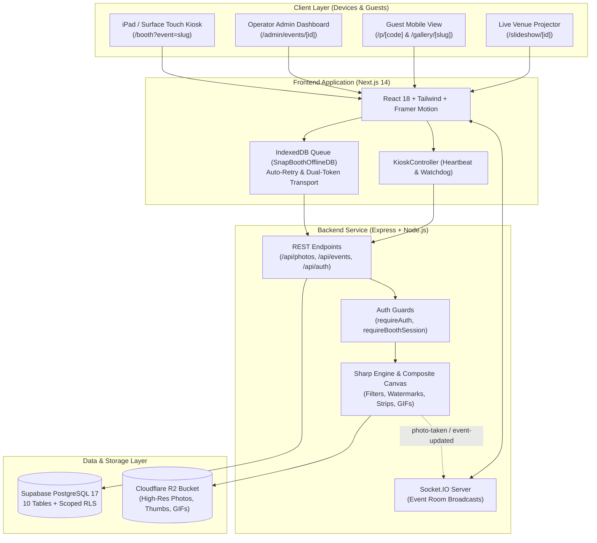

# SnapBooth AI — Next-Generation Photo Booth & Event Activation Platform

[](https://nextjs.org/)
[](https://nodejs.org/)
[](https://www.typescriptlang.org/)
[](https://tailwindcss.com/)
[](https://supabase.com/)
[]()

> **SnapBooth AI** is an enterprise-grade, offline-resilient photo booth platform engineered for iPad kiosks, Surface Pro tablets, touch monitors, venue projectors, and mobile web experiences. Built specifically for high-end weddings, brand activations, corporate galas, and live experiential entertainment.

---

## 🌐 Live Production Deployments

| Component | Target URL | Environment / Provider |
|:---|:---|:---|
| **Live Web App / Kiosk UI** | [`https://photobooth-v2-ten.vercel.app`](https://photobooth-v2-ten.vercel.app) | Vercel Edge / Node.js Serverless |
| **Backend REST & Socket.IO API** | [`https://photobooth-fzrn.onrender.com`](https://photobooth-fzrn.onrender.com) | Render Web Service (Continuous Deployment) |
| **Database & Auth** | Supabase PostgreSQL 17 (`hlhxbhraxtonjdieorvb`) | Sydney (`ap-southeast-2`) with Strict RLS |
| **Media Storage** | Cloudflare R2 Bucket / Supabase Storage Fallback | High-bandwidth low-latency global CDN |

---

## 🏛️ System Architecture



---

## 🚀 Key Functional Modules & Features

### 1. Studio Kiosk Workflow (`/booth`)
* **Attract & Idle Screen**: High-energy attract screen inviting guests to tap to start, featuring event branding, custom typography, and ambient media.
* **Style Selector**: Supports Single Portrait, 3-Shot Strip, Animated GIF, Boomerang, and AI Studio transformation modes.
* **Cinematic Countdown**: High-contrast, spring-physics radial countdown timer with zero distraction in the camera viewfinder.
* **Studio Customization Lab (Preview Editor)**:
  * **Celebrity Glam & Filters**: 1-tap presets including *Celebrity Glam B&W* (high contrast monochrome glow), *Hollywood Glow*, *Golden Hour*, *Editorial Vogue*, *Cyber Vivid*, and *Vintage Matte*.
  * **Interactive AR Digital Props & Stickers**: Drag-and-drop vector sticker canvas featuring sunglasses, visors, crowns, party hats, floral halos, mustaches, and sparkles with scaling (`+` / `-`), rotation (`↻`), and instant 1-tap delete (`✕`).
  * **Frame Overlays**: Instant preview and application of branded event borders.
* **Instant Guest Sharing**:
  * Dynamic scannable QR code generator for direct smartphone retrieval (`/p/[code]`).
  * SMS and Email delivery with customizable message templates.
  * Direct 1-tap WhatsApp sharing link.
  * Native WebShare API trigger for mobile kiosk setups.
* **Corporate Lead Capture & Survey Engine**:
  * Optional pre-share or post-capture modal collecting guest Name, Email, Phone, Company, Job Title, and custom survey questions.
  * CSV export and webhook integration for marketing CRM pipelines.

### 2. Mutually Exclusive Studio Theme & Background Engine
The booth operates in strictly **one** active background mode at any given time:
1. ☀️ **White Studio** (`light`): Crisp, bright studio aesthetic (`bg-slate-100`). Background image and video are disabled for maximum focus on portraits.
2. 🌙 **Dark Studio** (`dark`): Sleek midnight studio aesthetic (`bg-[#0a0a12]`). Clean solid dark backdrop.
3. 🎬 **Playing Video** (`video`): Ambient looping attract video on the idle attract screen. Transitions to solid dark studio during active capture and preview.
4. 🖼️ **Background Image** (`image`): Custom uploaded event wallpaper rendered on the idle attract screen. Completely isolated from capture and preview screens to prevent visual interference.

### 3. Operator Administration Hubs (`/admin/events/[id]`)
* **Live Operations Hub**: Real-time event statistics, online kiosks, recent captures feed, and remote trigger controls.
* **Camera & Kiosk Hub**: Camera device selection, countdown duration, retake toggles, auto-reset timeout, and PIN management.
* **Design & Templates Hub**: Unified 4-mode background selector, primary/secondary brand palette picker, logo upload, footer text, and live responsive kiosk simulator.
* **Photos & Moderation Hub**: Full photo grid with 1-click hide/delete, bulk selection, short URL access, and high-res ZIP export.
* **Print & Hardware Hub**: Server-side print queue management, scale adjustments (70%–110%), copies per session, and printer status monitoring.
* **Leads & Analytics Hub**: Lead list inspection, survey response breakdown, conversion metrics, and CSV download.

### 4. Real-Time Venue Slideshow Stream (`/slideshow/[id]`)
* Full-screen projector view designed for secondary TV monitors and venue displays.
* Low-latency photo updates streamed via Socket.IO within 2 seconds of capture.
* Floating QR code corner leading directly to the live guest event gallery.
* Ken Burns animation with keyboard operator shortcuts (`Space` = Pause, `F` = Fullscreen, `Q` = Toggle QR, `Arrows` = Navigate).

---

## 🔒 Security & Tenancy Architecture

1. **Scoped Operator PIN Authentication**:
   * Event operators log in using a 4-digit PIN via `POST /api/auth/operator-login`.
   * Backend performs constant-time string comparison (`crypto.timingSafeEqual`) to prevent timing attacks.
   * Issues a 12-hour scoped JWT restricted to `role: 'operator'` and the specific `eventId`.
2. **Booth Session Dual-Transport Guard**:
   * Kiosk uploads are protected by `requireBoothSession` middleware.
   * `GET /api/events/:id` automatically issues signed 7-day booth tokens for active events.
   * Frontend `api.ts` transmits the booth token simultaneously via HTTP header (`x-booth-session`) and request body (`boothToken` / `sessionToken`) with auto-refresh recovery.
3. **Multi-Tenant Data Isolation & RLS**:
   * All 10 Supabase PostgreSQL tables are locked down with Row Level Security (RLS).
   * Event mutation (`PUT`, `DELETE`) strictly enforces `owner_id = req.user.id`.
   * Public DTOs automatically sanitize operator PINs, webhook secrets, and client emails.
4. **Photo Privacy & Moderation**:
   * Photos marked `is_hidden = true` return HTTP 404 to all public gallery, QR, and slideshow endpoints, while remaining visible to the authenticated owner.
   * Sharing hidden photos via email or SMS is explicitly blocked by backend validation.
5. **Upload Deduplication & Idempotency**:
   * Client captures generate unique idempotency keys (`clientCaptureId`).
   * Backend prevents duplicate database inserts on network retries, returning existing photo records seamlessly.

---

## 📊 Database Schema (Supabase PostgreSQL 17)

| Table | Description | Primary Columns |
|:---|:---|:---|
| `events` | Core event registry | `id`, `owner_id`, `name`, `slug`, `date`, `venue`, `status`, `branding`, `settings`, `operator_pin`, `gallery_password`, `gallery_expires_at` |
| `photos` | Captured photos & media | `id`, `event_id`, `owner_id`, `session_id`, `url`, `thumb_url`, `gallery_url`, `short_code`, `mode`, `is_hidden`, `metadata`, `created_at` |
| `leads` | Guest contact capture | `id`, `event_id`, `name`, `email`, `phone`, `company`, `survey_answers`, `created_at` |
| `print_jobs` | Server-side print queue | `id`, `event_id`, `photo_id`, `status` (`pending`/`printing`/`completed`/`failed`), `copies`, `created_at` |
| `event_styles` | AI style catalog per event | `id`, `event_id`, `name`, `prompt`, `preview_image_url`, `is_active`, `sort_order` |
| `event_frames` | Branded PNG frame overlays | `id`, `event_id`, `name`, `url`, `is_active`, `created_at` |
| `operators` | Fleet staff accounts | `id`, `event_id`, `name`, `role`, `pin`, `created_at` |
| `analytics` | Telemetry & event tracking | `id`, `event_id`, `action`, `metadata`, `created_at` |
| `subscriptions`| Stripe tenant plan tiers | `id`, `user_id`, `email`, `stripe_customer_id`, `plan`, `status`, `current_period_end` |
| `user_subscriptions`| Legacy subscription mapping | `id`, `user_id`, `tier`, `photo_limit`, `created_at` |

---

## 📡 REST API Route Catalog

### Events & Configuration
* `GET /api/events` — List events owned by authenticated user (`requireAuth`).
* `GET /api/events/:id` — Fetch event details (returns public sanitized DTO + booth session token for kiosk).
* `POST /api/events` — Create new event (`requireAuth`).
* `PUT /api/events/:id` — Update event settings, branding, and broadcast via Socket.IO (`requireAuth`).
* `DELETE /api/events/:id` — Delete event and cascade purge media (`requireAuth`).
* `POST /api/events/:id/gallery-auth` — Authenticate password-protected gallery.
* `POST /api/events/:id/booth-session` — Issue scoped booth token for authorized operator.

### Photos & Ingestion
* `POST /api/photos/upload` — Ingest single photo with branding overlay, generate QR code, and persist to DB (`requireBoothSession`).
* `POST /api/photos/strip` — Composite 3-shot photo strip with event logo and branding footer.
* `POST /api/photos/gif` — Assemble multi-frame animated GIF or Boomerang.
* `POST /api/photos/burst` — Ingest high-speed burst captures.
* `GET /api/photos/event/:eventId` — Paginated event gallery retrieval.
* `GET /api/photos/short/:shortCode` — Direct short-link photo resolution for QR scans.
* `DELETE /api/photos/:photoId` — Moderation delete photo from DB and cloud storage (`requireAuth`).
* `PATCH /api/photos/:photoId/visibility` — Toggle public gallery visibility (`is_hidden`).

### Sharing & Print
* `POST /api/share/email` — Send photo link to guest email via Resend API.
* `POST /api/share/sms` — Send SMS via Twilio with custom event message.
* `POST /api/print/queue` — Enqueue print job for kiosk print station.
* `GET /api/print/queue/:eventId` — Polling queue for local hardware printer agent.
* `PATCH /api/print/queue/:jobId` — Update print job status (`printing` / `completed`).

### Leads & Analytics
* `POST /api/leads` — Ingest attendee lead information and survey answers.
* `GET /api/leads/event/:eventId` — Retrieve collected leads for export (`requireAuth`).
* `GET /api/leads/event/:eventId/export` — Download CSV of collected event leads.
* `POST /api/analytics` — Log kiosk interaction telemetry (`photo_taken`, `photo_shared`, `photo_printed`).

---

## 🛠️ Local Development & Setup

### Prerequisites
* **Node.js**: v18.17.0 or higher (Node 20+ recommended)
* **npm**: v9+
* **Supabase CLI / Project**: Active PostgreSQL instance

### 1. Clone & Install Dependencies
```bash
# Clone the repository
git clone https://github.com/Kavindraramdeni/photobooth_v2.git
cd photobooth_v2

# Install backend dependencies
cd backend
npm install

# Install frontend dependencies
cd ../frontend
npm install
```

### 2. Environment Configuration

#### Backend (`backend/.env`)
```env
PORT=3001
NODE_ENV=development
FRONTEND_URL=http://localhost:3000
JWT_SECRET=your-super-secure-jwt-secret-key-32-chars-min

# Supabase
SUPABASE_URL=https://your-project.supabase.co
SUPABASE_SERVICE_KEY=your-supabase-service-role-key
SUPABASE_ANON_KEY=your-supabase-anon-key

# Storage (Cloudflare R2 or Supabase Fallback)
R2_ACCOUNT_ID=
R2_ACCESS_KEY_ID=
R2_SECRET_ACCESS_KEY=
R2_BUCKET_NAME=photobooth-media
R2_PUBLIC_URL=https://media.yourdomain.com

# Email & SMS (Optional for local testing)
RESEND_API_KEY=
TWILIO_ACCOUNT_SID=
TWILIO_AUTH_TOKEN=
TWILIO_PHONE_NUMBER=
```

#### Frontend (`frontend/.env.local`)
```env
NEXT_PUBLIC_API_URL=http://localhost:3001
NEXT_PUBLIC_SUPABASE_URL=https://your-project.supabase.co
NEXT_PUBLIC_SUPABASE_ANON_KEY=your-supabase-anon-key
```

### 3. Running Locally
```bash
# Terminal 1: Start Backend (Port 3001)
cd backend
npm run dev

# Terminal 2: Start Frontend (Port 3000)
cd frontend
npm run dev
```

### 4. Verification & Testing
```bash
# Run backend test suite (78 tests)
cd backend
npm test

# Run frontend type checking & production build
cd frontend
npx tsc --noEmit
npm run build
```

---

## 📦 Deployment Workflow

* **Frontend (Vercel)**: Pushes to `main` branch trigger continuous deployment on Vercel at `https://photobooth-v2-ten.vercel.app`.
* **Backend (Render)**: Pushes to `main` branch trigger automated Docker/Node builds on Render at `https://photobooth-fzrn.onrender.com`.
* **Production Status**: Clean exit code 0 on all automated unit tests (`78/78 passing`) and production build (`12/12 routes static`).
